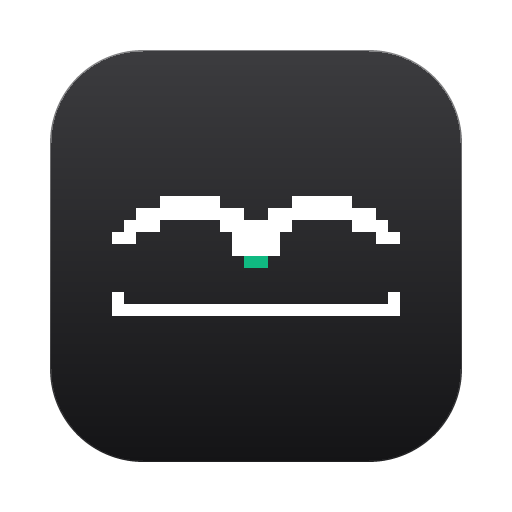
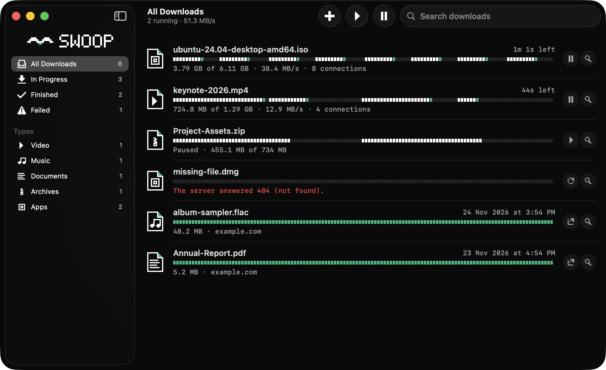
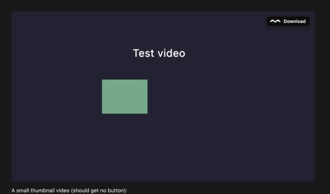
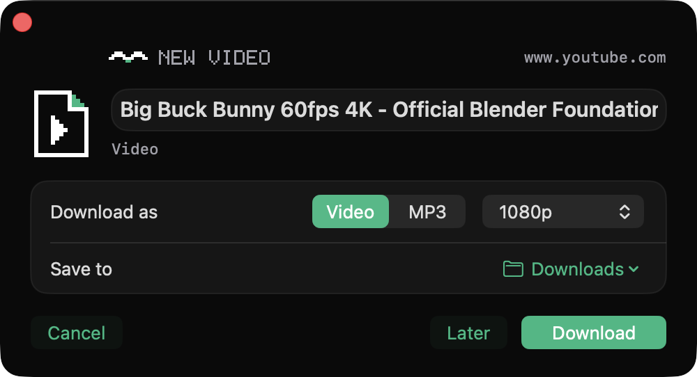
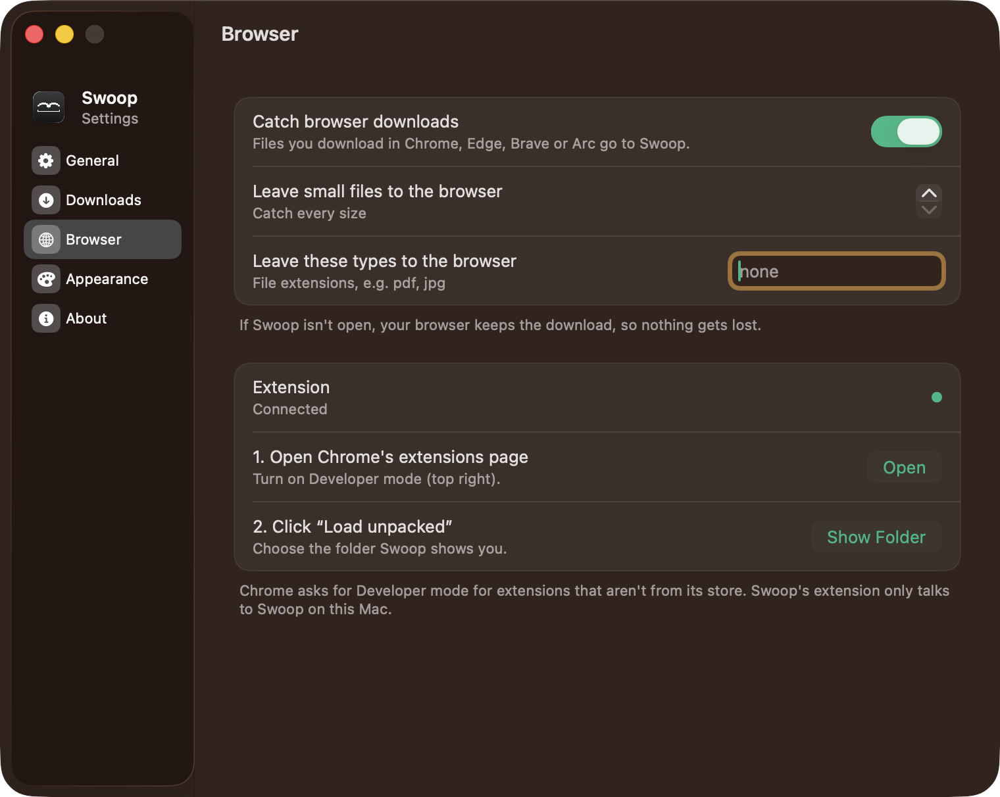
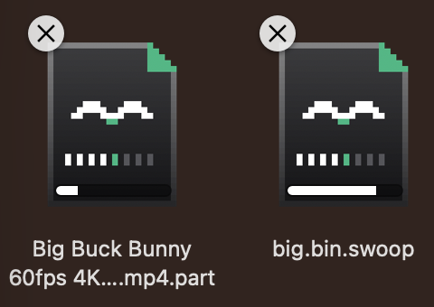

  

<h1 align="center">Swoop</h1>

  <b>Fast downloads for your Mac.</b> 
  Swoop splits every file across many connections, picks up where it left off, catches the downloads you start in your browser, and saves videos from YouTube and most video sites.

  

  
  
  

  

## Download

Get **[Swoop.dmg](https://github.com/kakhaliel/Swoop-Releases/releases/latest/download/Swoop.dmg)** (latest version) or pick a version on the [Releases](https://github.com/kakhaliel/Swoop-Releases/releases) page.

## Features

### Many connections at once
Many servers cap the speed of each connection. Swoop opens several (8 to start) and adds more while the download keeps getting faster, up to 32. Each bar shows where every connection is writing, in green.

### Pause, quit, pick up again
Pause any download and resume it later, even after quitting Swoop or restarting your Mac. If the file changed on the server in the meantime, Swoop notices instead of mixing two versions, and resuming starts it fresh.

### Videos and MP3s
Point at a video on YouTube, Vimeo, X, Instagram, TikTok or most other sites, including sites with their own embedded players, and click **Download**. For each download, pick the quality (up to 4K) or **MP3** to keep only the sound. Swoop prefers H.264, and converts VP9 / AV1 / MKV videos to H.264 MP4 after downloading, so every Mac can play the result.

The first time, Swoop asks to download two free, open-source tools it uses for videos, [yt-dlp](https://github.com/yt-dlp/yt-dlp) and [ffmpeg](https://ffmpeg.org), checks them, and keeps yt-dlp up to date.

### Swoop's own download window
Every download from the browser opens Swoop's window instead of the browser's "Save As": rename the file, see its size, pick the folder (Downloads, Desktop, Movies… or any other), choose the quality for videos, then **Download**, **Later** or **Cancel**. You can turn it off in Settings → Browser.

### Catches your browser's downloads
The Swoop extension for Chrome, Edge, Brave and Arc sends the files you download straight to Swoop, with the cookies they need. Right-click any link and choose **Download with Swoop**. If Swoop isn't open, your browser keeps the download, so nothing gets lost.

### In Finder too
Files still downloading show Swoop's icon with a progress bar, and the ✕ on them pauses the download.

### Always in the menu bar
The gull in the menu bar shows the total speed while something downloads. Its menu lists what's running, and it can start a download from a link you just copied.

### And the rest
- A queue: 3 downloads at a time by default, the rest wait their turn.
- **Clear Finished** (⌘⇧K) removes every finished download from the list at once; the files stay.
- Updates itself: Swoop shows what's new and installs a new version with one click.
- Sorted by type (video, music, documents, archives, apps, images), with search.
- A notification when a download finishes.
- Pixel look, or Classic with the standard macOS icons, in any accent color you like.

## Install

1. Open `Swoop.dmg` and drag **Swoop** into **Applications**.
2. Open Swoop. The first time, macOS says it can't check the app: click **Done**, then go to **System Settings → Privacy & Security** and click **Open Anyway**. (Swoop is signed ad-hoc, without an Apple Developer ID.)
3. Swoop lives in the Dock and the menu bar. Settings: **Swoop → Settings…** (⌘,).

### The browser extension (Chrome, Edge, Brave, Arc)
1. In Swoop, open **Settings → Browser** and click **Open** next to step 1. Turn on **Developer mode** in the top right of Chrome's extensions page.
2. Click **Load unpacked** in Chrome, then click **Show Folder** in Swoop and choose that folder.
3. Pin the gull to the toolbar. Its popup says **Connected to Swoop** when everything works.
4. Updating Swoop? Click **Reload** on the extension in `chrome://extensions` afterwards.

## Permissions

| Permission | Why |
|---|---|
| Notifications | To tell you when a download finishes. You can turn it off in Settings. |
| Browser extension: downloads, cookies, all sites | To hand a download to Swoop with the cookies the site needs, and to show the Download button on videos. It talks only to Swoop on your Mac (127.0.0.1). |

Swoop connects only to the servers you download from and, for videos, to the official pages of yt-dlp and ffmpeg to fetch and update them. No accounts, no analytics.

## Requirements

macOS 14 or newer, Apple Silicon or Intel.

## What's new

See [CHANGELOG.md](CHANGELOG.md).

---

This repository holds releases only; the source code is private.

  Developed by <a href="https://khalidkhalil.dev">Khalid Khalil</a> · info@khalidkhalil.dev · © 2026 Khalid Khalil

