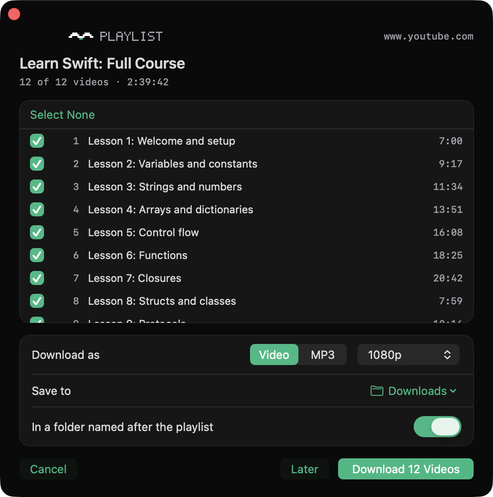
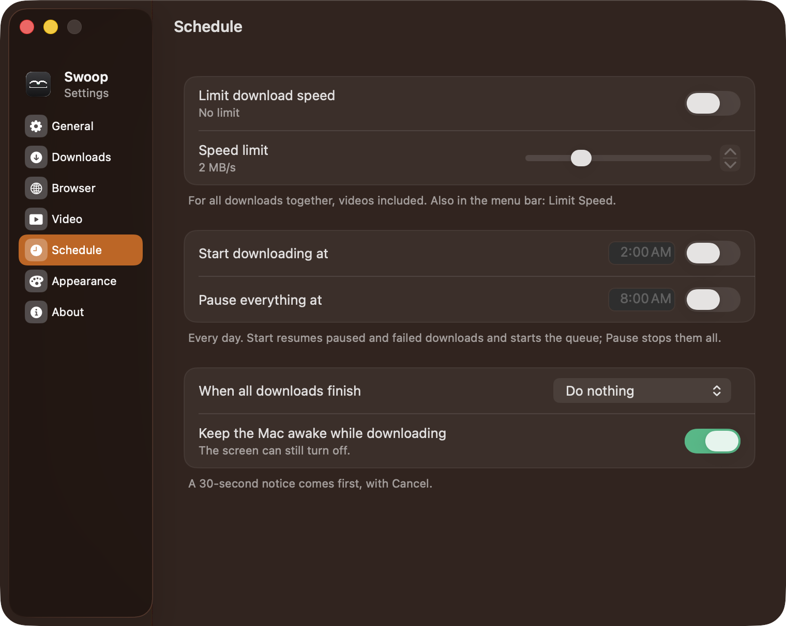
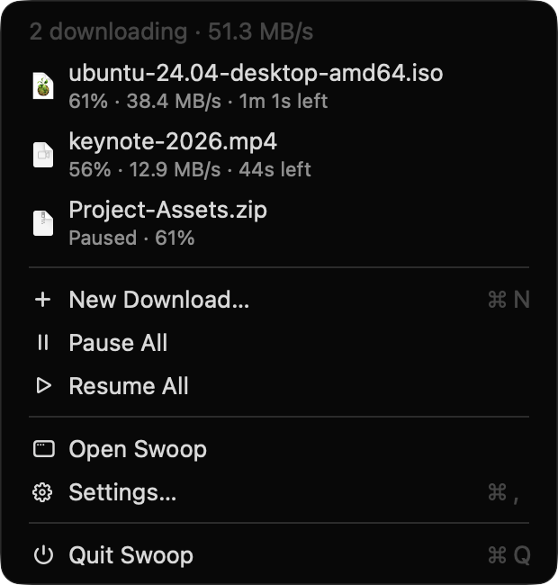
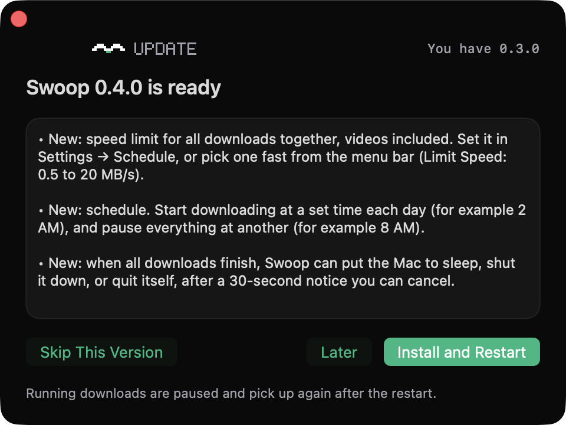
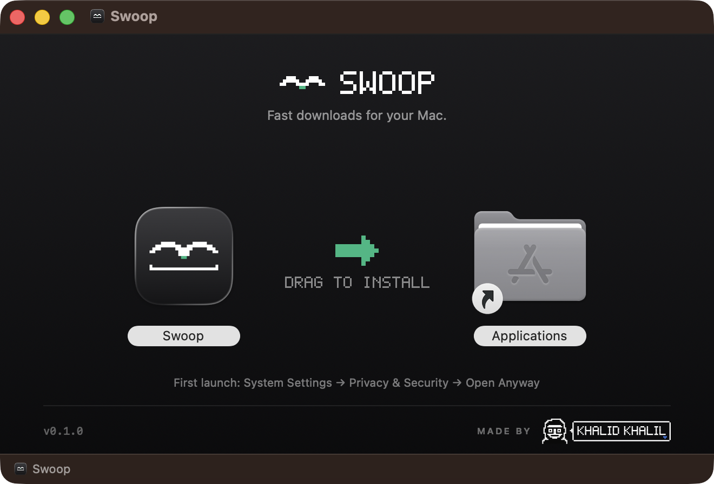

  

<h1 align="center">Swoop</h1>

  <b>Fast downloads for your Mac.</b> 
  Many connections per file, videos and MP3s from almost any site, your browser's downloads in one place, and a schedule for the night.

  

  
  
  

  

## Download

Get **[Swoop.dmg](https://github.com/kakhaliel/Swoop-Releases/releases/latest/download/Swoop.dmg)** (latest version) or pick a version on the [Releases](https://github.com/kakhaliel/Swoop-Releases/releases) page. After that, Swoop keeps itself up to date.

## Features

### ⚡ Many connections at once
Many servers cap the speed of each connection. Swoop opens several per file (8 to start) and adds more while the download keeps getting faster, up to 32. The bar under each file shows where every connection is writing, in green.

### ⏯️ Pause, quit, pick up again
Pause any download and resume it later, even after quitting Swoop or restarting your Mac. If the file changed on the server in the meantime, Swoop notices instead of mixing two versions. When a site is slow or the connection drops, Swoop tries again by itself.

### 🎬 Videos and MP3s
YouTube, Vimeo, X, Instagram reels, TikTok, Facebook, Reddit, SoundCloud and most other sites, including sites with their own embedded players. Pick the quality (up to 4K) or **MP3** for each download. Videos that come as VP9, AV1 or MKV are converted to H.264 MP4, so QuickTime and every Mac app play them. Portrait videos (reels, shorts) get the full quality you picked.

The first time, Swoop asks to download two free, open-source tools it uses for videos, [yt-dlp](https://github.com/yt-dlp/yt-dlp) and [ffmpeg](https://ffmpeg.org). It checks them and keeps yt-dlp up to date.

### 📚 Playlists
Give Swoop a playlist (a course, an album, a series) and pick the videos you want. They download in order as "01 - Title", "02 - Title"… in a folder named after the playlist, as video or MP3. A link to one video inside a playlist offers the whole playlist, or just that video.

### 🌐 Browser extension (Chrome, Edge, Brave, Arc)
- Files you download go to Swoop with the cookies the site needs, before the browser's own "Save As" window.
- A **Download** button appears over any video you point at, even in embedded players and full screen.
- Right-click any link, video or image: **Download with Swoop**.
- If Swoop isn't open, the browser keeps the download, so nothing gets lost.

### 🪟 Swoop's own download window
Every download from the browser opens Swoop's window: rename the file, see its size, pick the folder (Downloads, Desktop, Movies… or any other), choose Video or MP3 and the quality, then **Download**, **Later** or **Cancel**. You can turn it off in Settings → Browser.

### 🌙 Speed limit and schedule
- **Speed limit** for all downloads together, videos included. Set it in Settings, or pick one from the menu bar.
- **Start** downloading at a set time each day (2 AM, say) and **pause** everything at another (8 AM).
- **When all downloads finish**, Swoop can put the Mac to sleep, shut it down, or quit, after a 30-second notice you can cancel.
- The Mac doesn't go to sleep on its own while something downloads (the screen still can).

### 🕊️ Menu bar
The gull shows the total speed while something downloads. Its menu lists what's running, starts the link you just copied (**Download Copied Link**), limits the speed, and clears finished downloads.

### 📁 In Finder too
Files still downloading show Swoop's icon with a progress bar, and the ✕ on them pauses the download.

### 🔄 Updates itself
Swoop checks for a new version at launch and every few hours, shows what's new, and installs it with one click. Running downloads are paused and pick up again after the restart.

### ✨ And the rest
- A queue: 3 downloads at a time by default, the rest wait their turn.
- Sorted by type (video, music, documents, archives, apps, images), with search.
- **Clear Finished** (⌘⇧K) removes every finished download from the list at once. The files stay.
- A notification when a download finishes.
- Pixel look, or Classic with the standard macOS icons, in any accent color you like.
- A short pixel animation when you open Swoop: an arrow drops into the tray and the gull rises out. A click skips it, and Settings → Appearance turns it off.

## Install

1. Open `Swoop.dmg` and drag **Swoop** into **Applications**.
2. Open Swoop. The first time, macOS says it can't check the app: click **Done**, then go to **System Settings → Privacy & Security** and click **Open Anyway**. (Swoop is signed ad-hoc, without an Apple Developer ID.)
3. Swoop lives in the Dock and the menu bar. Settings: **Swoop → Settings…** (⌘,).

### The browser extension (Chrome, Edge, Brave, Arc)
1. In Swoop, open **Settings → Browser** and click **Open** next to step 1. Turn on **Developer mode** in the top right of Chrome's extensions page.
2. Click **Load unpacked** in Chrome, then click **Show Folder** in Swoop and choose that folder.
3. Pin the gull to the toolbar. Its popup says **Connected to Swoop** when everything works.
4. After an update that brings a new extension, Swoop reminds you to click **Reload** on it in `chrome://extensions`.

## Permissions

| Permission | Why |
|---|---|
| Notifications | To tell you when a download finishes or an update is ready. You can turn them off. |
| Automation (System Events) | Only if you choose "Shut down the Mac" when downloads finish. |
| Browser extension: downloads, cookies, web requests, all sites | To hand a download to Swoop with the cookies the site needs, to find the video a page is playing, and to show the Download button on videos. It talks only to Swoop on your Mac (127.0.0.1). |

Swoop connects only to the servers you download from, to GitHub to check for updates, and, for videos, to the official pages of yt-dlp and ffmpeg to fetch and update them. No accounts, no analytics.

## Requirements

macOS 14 or newer, Apple Silicon or Intel.

## What's new

See [CHANGELOG.md](CHANGELOG.md).

---

This repository holds releases only; the source code is private.

  Developed by <a href="https://khalidkhalil.dev">Khalid Khalil</a> · info@khalidkhalil.dev · © 2026 Khalid Khalil

